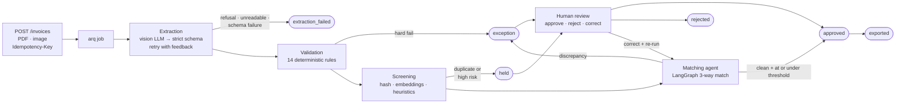

# APilot — AI Invoice Intelligence API

An agentic accounts-payable automation engine. It extracts structured data from
invoice PDFs and images with a vision LLM, validates it with deterministic business
rules, runs autonomous 3-way matching against purchase orders and receiving records,
catches duplicates and fraud signals, and routes exceptions to a human review queue —
behind a production-grade FastAPI service with a field-level evaluation harness.

**The thesis: LLMs extract, code decides.** The model transcribes documents. Every
consequential judgment — does the arithmetic hold, does this match the PO, may it be
approved — is made by deterministic code you can read and a test can pin.

**Built with** — Python 3.13 · FastAPI · Pydantic v2 · PostgreSQL 17 + pgvector ·
SQLAlchemy 2 (async, asyncpg) · Alembic · Redis + arq · LangGraph · Anthropic Claude
API · fastembed · rapidfuzz + SciPy · structlog · Prometheus · Typer · MCP · Docker
Compose · pytest + testcontainers · ruff · mypy (strict) · uv · GitHub Actions.
[Why each one ↓](#stack)

- **Eval report:** [`evals/latest_report.md`](evals/latest_report.md) ·
  **Architecture decisions:** [`docs/architecture.md`](docs/architecture.md) ·
  **Fraud signals:** [`docs/fraud-signals.md`](docs/fraud-signals.md) ·
  **MCP server:** [`docs/mcp.md`](docs/mcp.md)

---

## The problem

Accounts payable is one of the most expensive, error-prone back-office functions in
any company, and most of it is still manual. Published AP benchmarks (Ardent
Partners, APQC, IOFM, 2024–2026) put manual processing at roughly **$15 per invoice**
and **~14 days** per cycle, with about **39%** of manually-handled invoices containing
errors and roughly **2% of invoices paid twice** without systematic duplicate
detection — about $200K per $10M of annual payables.

| Metric | Manual baseline | What this system targets |
|---|---|---|
| Cost per invoice | ~$15 | Under $3 — LLM cost is **measured per invoice**, not estimated |
| Cycle time (receipt → decision) | ~14 days | Seconds for clean invoices |
| Invoices needing human touch | 100% | Only exceptions |
| Duplicate payments | ~2% of spend | Detected pre-approval, held with an explanation |
| Data-entry error rate | ~39% | Field-level accuracy measured and published |

---

## Quickstart

```bash
docker compose up -d          # Postgres (host 5433), Redis (6380), API (8000), worker
make migrate
make demo                     # three invoices through the whole pipeline
```

`make demo` seeds vendors/POs/receipts, uploads a clean invoice, an over-billed one,
and a re-submitted duplicate, then shows the matching verdict, review queue, CSV
export, and analytics. **It runs entirely offline** on the deterministic FakeLLM —
no API key required. Add `ANTHROPIC_API_KEY` to `.env` to run against a real model.

Interactive API docs: <http://localhost:8000/docs>

<details>
<summary>Local development without Docker for the app</summary>

```bash
uv sync --all-groups
docker compose up -d db redis
make migrate
make api        # uvicorn with reload
make worker     # arq worker
make ci         # ruff + mypy + unit + integration (testcontainers)
```
</details>

---

## How an invoice flows



Statuses are a validated state machine: every transition passes through one function
that stamps timestamps and writes an audit row **in the same transaction**. A unit
test walks the graph and proves no invoice can get stuck.

---

## What makes it different

### Extraction that fails honestly

The system never invents a value. Three distinct failure modes, three deliberate
responses:

| Failure | Response |
|---|---|
| Model refuses | Terminal `extraction_failed`, no retry — retrying a refusal is wasted money |
| Output doesn't fit the schema | Re-prompt with the previous output and a numbered error list (max 2 retries), then terminal |
| **Document's own math is wrong** | Retry once in case it's a misread, then **accept the extraction as-is** |

That last row is the thesis in miniature. An invoice whose printed total genuinely
doesn't equal subtotal + tax was extracted *correctly* — the document is wrong, not
the model. It gets persisted verbatim and routed to a human by the validation
engine. There's an integration test asserting exactly that.

### Money is never a float

`Decimal` in Python, `NUMERIC` in Postgres, and **strings on both wires** — the model
is instructed to emit `"1234.56"`, and API responses serialize Decimals as strings.
Equality is currency-aware: one unit in the currency's last decimal place, so JPY
(0 decimals) and BHD (3) are handled correctly by the same code.

### 14 deterministic rules, zero LLM calls

Pure functions over extracted values. Hard failures route to the human queue; flags
annotate without gating.

| Hard failures | Flags |
|---|---|
| V-001 line math · V-002 line sum = subtotal · V-003 subtotal + tax = total | V-004 tax rate > 50% · V-010 invoice before PO |
| V-005 unsupported currency · V-006 negative amounts · V-007 no line items | V-011 duplicate lines · V-012 unknown vendor |
| V-008 impossible dates · V-009 due date before invoice date | V-013 low extraction confidence · V-014 zero total |

### A matching agent that can't approve anything

```
po_lookup → line_align → compute_diffs → [investigate] → assemble_verdict
```

PO resolution, line alignment (exact match, then optimal Hungarian assignment over
fuzzy description similarity), and all discrepancy arithmetic are plain code. The
single LLM node runs **only** when the deterministic pass leaves real ambiguity — a
price drift needing vendor-history context, unmatched lines on both sides. It gets
four tool turns with read-only tools, may *propose* line pairings, and code
re-validates every proposal before recomputing the diffs.

Consequences, each covered by a test:

- A clean invoice costs **zero** LLM tokens in matching.
- A missing PO short-circuits to an exception without a model call — spending tokens
  to *guess* at a purchase order would invert the product's honesty stance.
- `auto_approve_eligible` is computed from deterministic checks and the configured
  threshold. The model's only outputs are pairing hints and prose.

Every node emits a trace event, persisted with the verdict and mirrored into the
audit log:

```json
{
  "verdict": "exception",
  "auto_approve_eligible": false,
  "checks": {"po_found": true, "vendor_match": true, "quantity_match": false,
             "price_match": true, "receipt_match": true},
  "discrepancies": [{"type": "quantity_mismatch", "line": "Widget A-200",
                     "invoice_qty": "12", "po_qty": "10",
                     "impact": {"amount": "94.00", "currency": "USD"}}],
  "agent_summary": "Invoice bills 12 units of Widget A-200 against PO-2231 which
                    authorizes 10; receiving records confirm 10 delivered…",
  "trace_id": "tr_9921"
}
```

### Duplicate and fraud detection, cheapest layer first

Exact file/key hashing → pgvector near-duplicate search with fuzzy cross-checks →
six heuristic flags. Bank-detail changes (the classic AP fraud vector) are detected
via HMAC fingerprints — **the raw bank details are never stored**, and a test asserts
they never reach the database. Nothing auto-rejects; the worst outcome is `held` with
a written explanation. Full detail in [`docs/fraud-signals.md`](docs/fraud-signals.md).

### Costs measured, not estimated

Every LLM attempt — retries included — writes a ledger row with all four token counts
(input, output, cache write, cache read) and a Decimal USD cost.
`GET /analytics/summary` reports cost per invoice, auto-approval rate, exception
reasons, and p95 cycle time from what actually happened.

---

## Evaluation harness

Ground truth here is *objective*: the invoice either says $1,240.50 or it doesn't.
The dataset is synthetic invoices whose arithmetic is exact by construction, plus
seeded corruptions, matching discrepancies, and duplicate resubmissions with labeled
expected outcomes.

The four configurations are **real code paths**, not prompt variants — each maps to an
`ExtractionConfig` the production pipeline uses.

| Configuration | Totals F1 | Line items F1 | Doc exact match | Seeded errors caught |
|---|---|---|---|---|
| Naive single prompt (baseline) | 0.95 | 0.92 | 0.91 | **0%** |
| + strict schema & retry-with-feedback | 1.00 | 1.00 | 1.00 | **0%** |
| + deterministic validation layer | 1.00 | 1.00 | 1.00 | **100%** |

> **Read this table honestly.** These are **fixture-mode** numbers: the harness
> replays bootstrapped model outputs derived from ground truth through the real
> pipeline, so rows 2 and 3 are near-perfect by construction and the naive row's
> degradation comes from deliberately-injected malformed responses. They demonstrate
> that the *harness and pipeline* work end-to-end with zero secrets — they are **not**
> a measurement of a real model's accuracy. Live numbers require an API key and a
> recording run (`--mode live`); this README will be updated with them, clearly
> labeled, when that happens.
>
> What the third row *does* prove is architectural and real: adding the validation
> layer changes extraction metrics **not at all**, and takes seeded-error detection
> from 0% to 100%. That's the "LLMs extract, code decides" thesis, measured.

Full-pipeline metrics from the same run: matching accuracy **1.00**, discrepancy-type
accuracy **1.00**, duplicate-detection recall **1.00** with zero false holds.

```bash
uv run python -m evals.generator --dataset v1        # regenerate from the manifest seed
uv run python -m evals.run --mode fixture --config validation --dataset v1 --check
uv run python -m evals.promote_corrections --dataset v1   # reviewer fixes → eval cases
```

That last command closes the product's central loop: a human corrects a field in the
review queue, the correction is stored as ground truth, and the corrected invoice
becomes a labeled eval case tagged `provenance: reviewer_correction` — so the dataset
grows with exactly the real documents the system got wrong.

CI runs the harness on every push and fails the build if any gated metric drops more
than 2 points below the committed baseline or falls under its floor. Reports land in
`evals/reports/`; `evals/latest_report.md` always reflects the newest run per config.

---

## API

| Method | Endpoint | Scope | Description |
|---|---|---|---|
| `POST` | `/api/v1/invoices` | `ingest` | Upload (multipart) with `Idempotency-Key` → 202 + invoice id |
| `GET` | `/api/v1/invoices/{id}` | `read` | Full record: extraction, confidences, validation, flags, status |
| `GET` | `/api/v1/invoices/{id}/matching` | `read` | Agent verdict + replayable trace |
| `POST` | `/api/v1/invoices/{id}/review` | `review` | Approve / reject / correct (corrections → ground truth) |
| `POST` | `/api/v1/purchase-orders` | `ingest` | Seed/ingest POs |
| `POST` | `/api/v1/receipts` | `ingest` | Seed/ingest receiving records |
| `GET` | `/api/v1/exceptions` | `read` | Review queue, sorted by risk × amount |
| `GET` | `/api/v1/exports?format=csv\|quickbooks` | `export` | Accounting-ready output |
| `GET` | `/api/v1/analytics/summary` | `read` | Auto-approval rate, exception reasons, cost, cycle times |
| `GET` | `/health`, `/health/ready`, `/metrics` | — | Liveness, readiness, Prometheus |

Auth is `X-API-Key` with scopes (`ingest`, `read`, `review`, `export`); keys
are stored as SHA-256 hashes and minted via `uv run python -m app.cli keys create`.
Rate limits are per-key. Errors share one envelope:

```json
{"error": {"code": "idempotency_key_reuse", "message": "…", "request_id": "…", "details": []}}
```

**Idempotency:** same key + same bytes replays the original response with
`Idempotency-Replay: true`; same key + different bytes is a 409. A system built to
catch duplicate invoices must not create them.

---

## Stack

| Layer | Choice | Why |
|---|---|---|
| API | FastAPI + Pydantic v2 | Async-native, schema-enforced at every boundary |
| Data | PostgreSQL 17 + pgvector, SQLAlchemy 2 async, Alembic | Financial data is relational; embeddings live in the same database |
| Jobs | arq (Redis) | Extraction is genuinely async; one task per invoice with status checkpoints |
| LLM | Anthropic (`claude-opus-5` default) behind a provider protocol | Native PDF input, structured outputs, prompt caching; provider is config, not code |
| Agent | LangGraph | Explicit, replayable graph — not an unbounded loop |
| Embeddings | fastembed (local, 384-dim) | Near-duplicate detection without a second API key |
| Observability | structlog + request IDs, Prometheus, append-only audit log | Every state change, agent step, and LLM call is on the record |
| Quality | ruff, mypy (strict on `app/`), pytest + testcontainers | 234 tests; integration tests run real Postgres and real migrations |
| Interop | MCP server (stdio) | `extract_invoice`, `check_duplicates`, `match_invoice` for any MCP client |

Everything runs with **zero secrets** — the FakeLLM and FakeEmbeddings are complete
implementations of the same protocols, so CI, tests, and the demo are fully offline
and deterministic. Missing fixtures fail loudly rather than returning plausible
nonsense.

---

## Repository layout

```
app/
  api/v1/       invoices · matching · review · exceptions · POs · receipts · exports · analytics
  core/         config · logging · db · redis · security · ratelimit · money · normalize · fingerprint
  models/       SQLAlchemy models (invoice, PO, receipt, matching, review, audit, embeddings…)
  services/     pipeline · extraction · validation · dedup · matching · review · exports · analytics
  agent/        LangGraph graph · state · read-only tools
  llm/          client protocol · Anthropic client · FakeLLM · embeddings · pricing · prompts
  mcp_server/   MCP tool definitions
evals/          generator · runner · metrics · dataset · reports · thresholds
tests/          unit + integration (testcontainers)
docs/           architecture · fraud-signals · mcp · deploy
```

---

## Status and honest limitations

Built end to end and fully tested offline.

**Single-tenant by design.** The unit of isolation is the deployment, not a row: any
valid key with `read` can fetch any invoice in the database. Scopes divide what a key
may *do*, never what it may *see*. That is a boundary, not an oversight — a
`tenant_id` most queries filter on and one forgets is a system that looks isolated
and leaks. [ADR 10](docs/architecture.md) names the seam if that ever changes.

Before this served a real AP department it would need: object storage instead of a
local volume for multi-replica deployments, `/metrics` behind network policy, a
backup/restore runbook for the audit log, encryption at rest for invoice documents, a
retention and deletion path, read-access auditing, and — most importantly — **live
eval numbers**, which need an API key. See [`docs/deploy.md`](docs/deploy.md) for
deployment recipes.

Out of scope by design (v1): payment execution, ERP write-back connectors, OCR model
training, multi-currency consolidation. The system prepares approvals; it never moves
money.

## License

MIT
